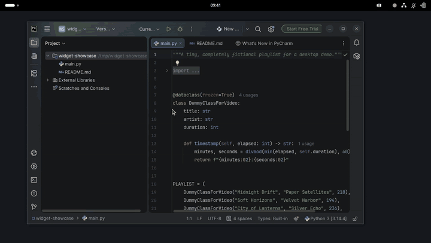

# Now Playing Card · Pinned Lyrics

A GNOME Shell extension that pins your now playing card above other windows. It works with Spotify and other players that expose MPRIS controls.



[Watch the 25-second desktop demo](docs/nowplaying-desktop-showcase.mp4)

- Click the top bar icon to open or close the card. The card stays in its chosen corner as you switch or move windows.
- Use the card to pause, skip or seek. Click **Lyrics** to open the lyrics panel.
- Synchronized lyrics show the previous line, the current line and the next two lines. The panel scrolls as the song plays and fades in individual words when word timings are available. Persian and mixed right-to-left text use native text shaping.

## Install

The extension was tested on GNOME Shell 50.1 on Wayland. Building from source requires Python 3, `zip` and the GLib schema tools. The extension uses the libsecret and libsoup 3 GObject introspection libraries provided by your distribution.

From the repository root, run:

```sh
bash tools/pack-extension.sh
gnome-extensions install nowplaying-pinned@local.shell-extension.zip
```

Log out and back in so GNOME Shell can load the extension, then enable it and open its settings:

```sh
gnome-extensions enable nowplaying-pinned@local
gnome-extensions prefs nowplaying-pinned@local
```

Choose the card's corner in preferences. Play a track and click the top bar icon to open the card.

## Lyrics sources

[LRCLIB](https://lrclib.net/) can match lyrics using track title, artist, album and duration without an account. The optional Spotify provider uses a login stored in the desktop keyring. It relies on an unofficial Spotify endpoint and falls back to LRCLIB if it cannot retrieve lyrics. The display uses line timing or plain text when individual word timings are unavailable.

## Development

The tests use Node.js and GJS.

```sh
node --test tests/*.test.mjs
glib-compile-schemas --strict --dry-run schemas
```

Based on [epogonii/nowplaying-card v1.0.12](https://github.com/epogonii/nowplaying-card/tree/v1.0.12). See [LICENSE](LICENSE) for the extension's license and [vendor/js-yaml.LICENSE](vendor/js-yaml.LICENSE) for the bundled parser.
